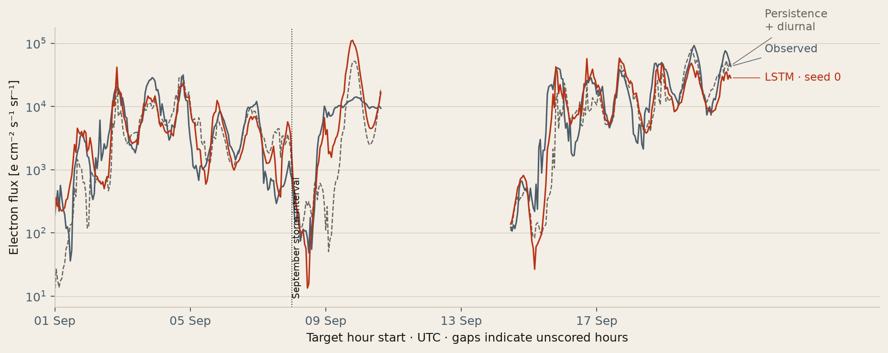

# Twelve-hour GEO electron-flux forecasting

The LSTM improves on the daily-cycle baseline. The mean test PE difference from persistence + diurnal is +0.135. This is a retrospective, hourly GOES-15 experiment by Jabin Joseph M and Joanna Preethi J, B.Tech AI & Data Science, LICET.

[Open the offline report](report/index.html) · [Share card](report/screens/social.png) · [Measured results](results/metrics.json) · [Viva handoff](docs/RESULTS_AND_VIVA.md)



## Measured results

| Forecast | Val PE | Val RMSE | Test PE | Test RMSE |
|---|---:|---:|---:|---:|
| Persistence | 0.358 | 0.912 | 0.290 | 0.864 |
| Persistence + diurnal | 0.707 | 0.617 | 0.680 | 0.580 |
| LSTM | 0.848 ± 0.002 | 0.444 ± 0.003 | 0.815 ± 0.001 | 0.441 ± 0.002 |

PE is on log10 forecast levels (higher is better); RMSE is in log10 flux units (lower is better). LSTM values are mean ± sample standard deviation across 3 seeds, not an ensemble score. Validation year 2016: 8,648 samples; held-out test year 2017: 8,262. Each model uses the same timestamps. Figures and named LSTM CSV columns show seed 0. Seed variability is not a confidence interval over storms.

## Reproduce

Run commands from the `source/` checkout in PowerShell. Python and Git must be installed. The current machine uses CPU PyTorch; exact verified dependencies are in `results/setup/requirements.freeze.txt`.

To start a new experiment from a clone that already contains the published results, use a separate checkout and preserve its existing results first:

```powershell
if (Test-Path -LiteralPath results_published) { throw 'Choose a fresh checkout; results_published already exists.' }
Move-Item -LiteralPath results -Destination results_published
```

The next commands create a new local results directory. Keep the original checkout and its local checkpoints intact. For exact dependency versions, after setup install `results_published/setup/requirements.freeze.txt` using the new environment's pip; the CPU torch package is installed first by setup.

```powershell
python scripts/setup_environment.py
.\.venv\Scripts\python.exe -m unittest discover -s tests -v
.\.venv\Scripts\python.exe src/download_data.py
.\.venv\Scripts\python.exe src/download_data.py --verify-only
.\.venv\Scripts\python.exe src/build_dataset.py
.\.venv\Scripts\python.exe src/baselines.py
.\.venv\Scripts\python.exe src/train.py
.\.venv\Scripts\python.exe src/evaluate.py
.\.venv\Scripts\python.exe src/render_report.py
.\.venv\Scripts\python.exe report/make_screens.py
.\.venv\Scripts\python.exe scripts/verify_project.py
```

These are fresh-experiment commands. Training refuses to run after `frozen_experiment.json` exists, protecting the held-out experiment. A completed local checkout can rerun evaluation, rendering and screenshots using its frozen checkpoints. Downloading skips validated files. Raw data, processed arrays, `.venv` and checkpoints are Git-ignored; reproduce them locally using these commands. In an unmodified published checkout, `scripts/verify_project.py` verifies the saved predictions and artifacts without raw data or checkpoints. Exact retraining results can vary across hardware, package releases or archive revisions even with the same seeds. On Linux/macOS use `.venv/bin/python` in place of the Windows interpreter path.

Screenshots use installed Microsoft Edge or Chrome when available; otherwise install Playwright Chromium with `.\.venv\Scripts\python.exe -m playwright install chromium`. The HTML opens directly from disk and makes no network requests. The report has no build system or backend.

## Method and data

Use 72 hourly rows × six features to predict delta = log10F(t+12h) − log10F(t). Forecast level = observed current log-flux + predicted delta. The 51,777-parameter LSTM uses two hidden layers, training-only normalization, AdamW and early stopping on validation MSE. Training order is chronological. Default configuration and seeds are fixed in `results/frozen_experiment.json`; the optional Transformer and tuning grid were omitted before test evaluation.

The 52,608-hour grid uses NOAA GOES-15 operational EPEAD E-detector corrected flux and NASA OMNI2 wind speed, Bz GSM and Dst. Average at least six quality-valid five-minute flux samples per hour in linear space, floor valid hourly means at one, then log10. Timestamp-based aggregation preserves missing archive records. Local solar time supplies sine/cosine features. See [protocol amendments](docs/PROTOCOL_AMENDMENTS.md), which supersede preliminary E/W averages and fixed score expectations in the original brief.

Rows are hour-start labels; forecasts are issued at hour end. The target is the hourly mean ending twelve hours after issue. Training is 2012–2015, validation 2016 and test 2017. Targets crossing either split boundary are excluded. Only complete, bounded gaps of at most three hours can be filled, and both endpoints must be available at issue time. Anchors and targets are never interpolated. Earlier observed history is allowed at the start of a later split.

## Verification and provenance

- Accepted training samples: 34,020; per-rule exclusions: `results/data_quality.json`.
- Annual observed E-only flux coverage: 98.90%–99.93%; floored hourly observations: 1,092.
- Training daily amplitude: 0.73236 log10; peak local-time bin: 11; 2015 minimum Dst: -234 nT.
- The 64-sample diagnostic passed with MSE 0.007055. Every saved checkpoint reproduced its validation predictions exactly when reloaded.
- All final PE/RMSE values were independently recomputed from saved per-seed predictions. Historical E/W baseline checks are recorded separately from corrected experiment results.
- Source URLs, retrieval dates, byte sizes, missing record counts and SHA-256 hashes: `results/data_manifest.json`. Source/config/data/checkpoint provenance: `results/runs/` and `results/frozen_experiment.json`.

All result numbers in this README are generated by `src/render_report.py` from `results/metrics.json`.

## Limitations

This is retrospective forecasting with archived inputs; processing latency is not modelled. One satellite and one test year limit generalization. Adjacent windows overlap, so samples are not independent. The operational electron product may retain proton contamination and calibration error. Missing inputs exclude some hours, including storm intervals. The flux floor changes low-level observations. Seed spread measures training variability, not confidence over future storms. This experiment does not establish operational warning skill.

## Sources

- [NOAA GOES operational archive](https://www.ncei.noaa.gov/data/goes-space-environment-monitor/access/avg/) and [instrument documentation](https://www.ncei.noaa.gov/products/goes-1-15/space-weather-instruments).
- [NASA OMNI2 format](https://spdf.gsfc.nasa.gov/pub/data/omni/low_res_omni/omni2.text) and [time preparation](https://omniweb.gsfc.nasa.gov/html/omni2_doc_addition.html).
- [Rodriguez et al. (2025)](https://repository.library.noaa.gov/view/noaa/67315/noaa_67315_DS1.pdf), GOES-15 W-sensor degradation; motivation for E-only use. This project's operational product differs from the paper's science-quality input.
- [Sun et al. (2024)](https://doi.org/10.1051/swsc/2024021), context for LSTM/Transformer forecasting. Different satellites, sampling and periods prevent direct score ranking.

Student ownership includes understanding, reviewing and explaining the implementation and results; the author names do not assert an unverified division of implementation work.
